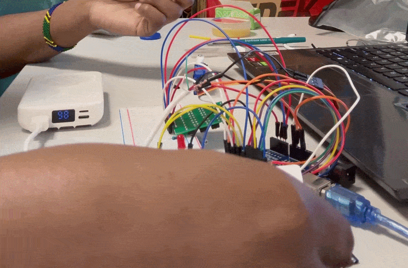

# RFID + PIN Door Lock

A two-factor authentication door lock built with Arduino. Tap a valid RFID card AND enter a PIN to unlock. Wrong card or wrong PIN flashes a red LED. Correct combination unlocks the servo-driven bolt for 3 seconds and a green LED flashes.

## Demo

## Features

- ✅ RFID card authentication (MFRC522)
- ✅ PIN entry via 4×4 keypad
- ✅ Two-factor security (card AND PIN)
- ✅ Servo-driven lock mechanism
- ✅ Green/red LED status feedback
- ✅ 3-attempt lockout (30 s)
- ✅ 30 s card-verification timeout
- ✅ External 5V supply for the servo (prevents brownouts)

## Hardware

| Component | Model | Notes |
| :--- | :--- | :--- |
| Microcontroller | Arduino Uno | or compatible |
| RFID reader | MFRC522 (RC522) | 13.56 MHz, SPI |
| Servo | SG90 | 0°–90° range used |
| Keypad | HW-834 (4×4 matrix) | 16 button module |
| LEDs | Green, Red | 5 mm, 220Ω resistors |
| Power supply | 5V USB power bank | for servo only |

## Wiring

### RFID (MFRC522)

| RC522 Pin | Arduino Pin |
| :--- | :--- |
| SDA (SS) | 10 |
| SCK | 13 |
| MOSI | 11 |
| MISO | 12 |
| RST | 9 |
| VCC | **3.3V** (⚠️ not 5V) |
| GND | GND |

### Servo (SG90)

| Servo Wire | Connects To |
| :--- | :--- |
| Signal (orange) | Arduino pin 3 |
| VCC (red) | External 5V supply (power bank) |
| GND (brown) | External GND **+** Arduino GND |

### LEDs

| LED | Arduino Pin | Resistor |
| :--- | :--- | :--- |
| Green | 6 | 220Ω to GND |
| Red | 7 | 220Ω to GND |

### Keypad (HW-834)

| HW-834 | Arduino |
| :--- | :--- |
| C4 | A0 |
| C3 | A1 |
| C2 | A2 |
| C1 | A3 |
| R1 | 2 |
| R2 | 4 |
| R3 | 5 |
| R4 | 8 |

## How It Works

1. **Idle**: Lock is closed, servo at 0°, both LEDs off.
2. **Card tap**: RFID reader scans. If UID matches an authorized card, it prints "Card OK" and waits up to 30 s for the PIN.
3. **PIN entry**: User presses the PIN buttons. Once 4 buttons are entered, the code compares against the correct PIN.
4. **Grant**: Green LED on, servo moves to 90°, holds for 3 s, then relocks. Failed counter resets.
5. **Deny**: Red LED flashes 1 s. After 3 failed attempts, the system locks out for 30 s.

## How to Build It

1. Wire the components per the tables above.
2. Install libraries in Arduino IDE:
   - **MFRC522** by GithubCommunity
   - **Keypad** by Mark Stanley & Alexander Brevig
   - **Servo** (built-in)
3. Open `src/rfid_pin_lock.ino` in the Arduino IDE.
4. **Change the card UID** to match your own card (see below).
5. **Change the PIN** in `const String CORRECT_PIN = "MIEA";`
6. Upload to the Arduino Uno.

### Finding Your Card's UID

Upload a small test sketch to print the UID of any card you tap. Copy the hex bytes into `authorizedUIDs[][]` in the main sketch.

## Configuration

| Setting | Location | Default |
| :--- | :--- | :--- |
| Card UIDs | `authorizedUIDs[][]` | `{0x53, 0x51, 0xCA, 0x56}` |
| PIN | `const String CORRECT_PIN` | `"MIEA"` |
| Unlock duration | `grantAccess()` → `delay(3000)` | 3 s |
| Card timeout | `CARD_TIMEOUT` | 30 s |
| Max attempts | `MAX_ATTEMPTS` | 3 |
| Lockout duration | `LOCKOUT_MS` | 30 s |
| Servo angles | `LOCKED_ANGLE` / `UNLOCKED_ANGLE` | 0° / 90° |

## Safety Notes

- **RC522 VCC must be 3.3V** — 5V will permanently damage it.
- **Servo powered from a separate 5V supply** — Arduino USB alone cannot provide enough current. The external GND must be shared with the Arduino GND.
- **Do not bridge +5V and GND wires** — this shorts the circuit.

